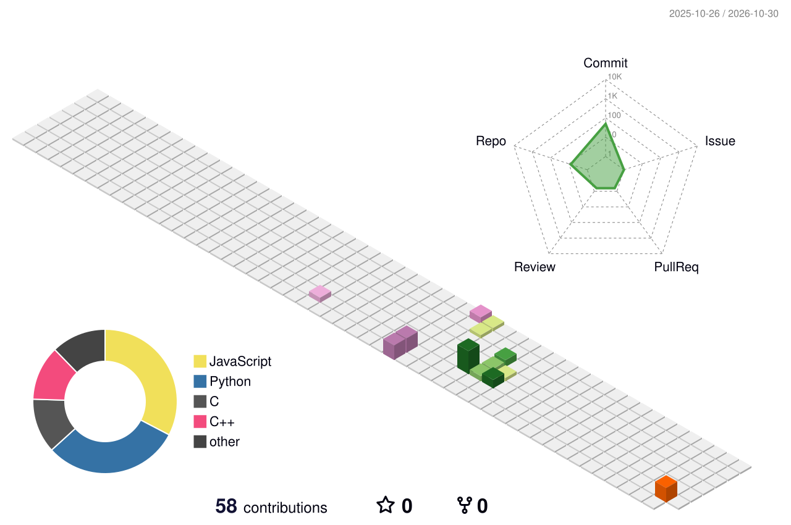

 <!-- https://readme-typing-svg.demolab.com/?lines=Hello+World!;Welcome+to+My+‌Personal+Homepage&font=Fira%20Code&pause=500 -->

<h1 align="center" style="border-bottom: none;">Hi 👋, My Name is Killerwy</h1>
<h3 align="center">A passionate developer from China</h3>

  
  
  

<h2 style="border-bottom: none;">🧑‍💻 About Me</h2>

  Hi, I'm Killerwy 👋, a programming novice who is continuously learning from China. 
  I’m currently exploring the world of programming, experimenting with different tech stacks and building small demo projects to consolidate what I’ve learned. 
  I love debugging, solving problems, and documenting every bit of my growth on GitHub.
  Open to suggestions and happy to communicate with fellow developers!
  
  Current Focus🎯:
  - Learning C/C++ and Qt desktop application development
  - Practicing full-stack web development and data visualization with Html / CSS / JavaScript / TypeScript
  - Exploring the world of artificial intelligence (e.g., LLM, Agent)
  - Trying all varieties of open source projects on Github

  My motto is as follows:

  

<h2 style="border-bottom: none;">🛠️ Tech Stack</h2>

  
  
  
  
  
  
  
  
  
  
  
  
  
  
  
  
  
  
  
  
  

<h2 style="border-bottom: none;">📊 GitHub Stats</h2>

  
  
  
  

<h2 style="border-bottom: none;">✨ My Repositories</h2>

<b>— 📌 Here are some representative projects I built during my learning journey: —</b>

  
  
  
  
  
  

<h2 style="border-bottom: none;">⚡ Recent Activities</h2>

> New commits & events are on the way! Stay tuned.

<!--START_SECTION:activity-->
1. ⭐ Starred [iconify/iconify](https://github.com/iconify/iconify) on Oct 20, 2026
2. 🔔 Watching [Ileriayo/markdown-badges](https://github.com/Ileriayo/markdown-badges) on Oct 20, 2026
3. 🔔 Watching [anuraghazra/github-readme-stats](https://github.com/anuraghazra/github-readme-stats) on Oct 20, 2026
4. 🔔 Watching [devicons/devicon](https://github.com/devicons/devicon) on Oct 20, 2026
5. ⭐ Starred [rzashakeri/beautify-github-profile](https://github.com/rzashakeri/beautify-github-profile) on Oct 20, 2026
6. 🔔 Watching [killerwy/house-rent-system](https://github.com/killerwy/house-rent-system) on Oct 17, 2026
7. ⭐ Starred [morluto/rea](https://github.com/morluto/rea) on Oct 15, 2026
8. ⭐ Starred [lyswhut/lx-music-desktop](https://github.com/lyswhut/lx-music-desktop) on Oct 15, 2026
<!--END_SECTION:activity-->

<h2 style="border-bottom: none;">📱 Connect With Me</h2>

If you want to discuss code, cooperate or just say hello, feel free to send me an email or message!

  
  
  
  

<h2 style="border-bottom: none;">❤️ Support Me</h2>

All my projects are open source and free. 

If my work helps you, you can support me with a cup of coffee ☕

  

  
   
  
  

